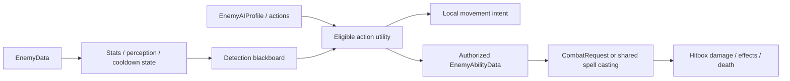
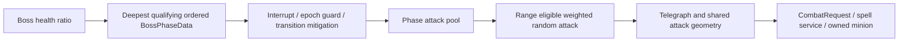

# Combat architecture

Player input is local-authority gated. The CHAINED resolver recognizes each exact completion immediately while retaining available longer-prefix continuations. Valid directions emit the accepted-input signal before spell execution; mana/cooldown failure can therefore follow a correct input burst. The compact assistant only presents eligible next directions. PlayerTargetLock automatically acquires a visible nearby hostile; Q cycles by distance without interrupting incantations. Each offensive request records its selected target, and aim tracks that actor through preparation. See [targeting and HUD details](../auto-targeting-and-buff-hud.md).

SpellCastingComponent validates Resource, actor authorization, costs, target, cooldown and status restrictions. It owns preparation/channel/recovery and queued requests. SpellDelivery chooses projectile/self/direct/area/beam/trap/summon delivery; SpellExecutor executes ordered typed effects under server/single-player authority. HitboxComponent owns mitigation and ActiveEffectManager. Effect Resources remain shared definitions, with each cast's counters in SpellCastContext.

Player casts opt into `immediate_chaining`: they skip post-dispatch recovery and drain queued instant requests on the same tick that preparation finishes. Each spell retains its own cooldown, mana and preparation/channel duration. Input consumes each event in order. Mutual body exceptions allow players to pass through monsters; contextual E pushes eligible enemies with a four-second cooldown. See [casting, pushback and filter details](../snappy-combat-and-spell-filters.md).

Enemy ability selection uses highest ready compatible ability weight, not a random probability roll. Utility action eligibility and commitment differ from boss attack selection:

World-space enemy feedback remains separate from the local screen HUD. Client cast RPC validation and full enemy/quest/projectile replication are not complete. A local preview is not a network permission boundary. See [spell internals](../spell-architecture-v2.md), [enemy internals](../enemy-pipeline-v2.md) and the authoring guides for exact supported mechanics.
