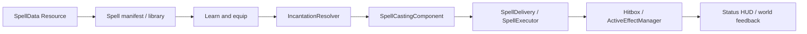

# Data-driven architecture

A **Resource** defines reusable authored data: SpellData, EnemyData or QuestData. A **scene** defines structure, presentation and collision: Enemy.tscn or a world-template instance. A **component** implements reusable runtime behavior such as EnemyCombat or HitboxComponent. A **controller/service** interprets definitions and coordinates state, such as SpellCastingComponent or QuestManager. A **registry/manifest** makes the data reachable by ID and retained in exported builds.

Ordinary content means composing existing supported behaviors. A new damage/slow spell or melee enemy should not require editing Player.gd or copying EnemyCombat. A genuinely new mechanic requires a reviewed extension at its behavior boundary; an arbitrary string alone cannot create behavior.

Resources are shared objects. Two enemies referencing one stats/profile Resource do not get separate mutable copies automatically. Actor HP, cooldowns, AI scores, active effects, quest objective progress and cast context belong to component instances/QuestInstance, not `.tres` files. Runtime adapters construct or duplicate definitions when adapting legacy data; they must not rewrite shared authored Resources. Inspector edits to an intentionally shared Resource affect all consumers.

Godot UIDs resolve asset identity across supported moves. Gameplay IDs match dictionaries, event targets and saved progression. Changing a UID does not migrate a saved spell_id; changing a spell_id does not repair an ext_resource UID. Read [identifiers](../reference/identifiers-and-conventions.md) before content evolution.
