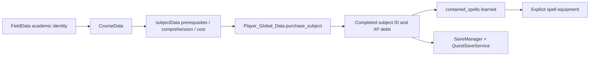
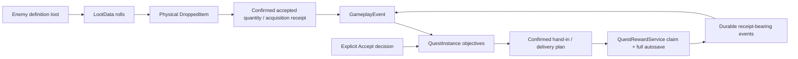

# Progression architecture

Purchase checks the course relationship and validation, subject/course prerequisite subject IDs, comprehension ranks, valid spell references and available XP. Cost is `int(30 * max(difficulty,1)^2 * comprehension_multiplier * (1 + spell_count*0.25))` using the subject's comprehension label (1, 1.5, 2.25, 3.5 for Novice through Expert). Completion is recorded before signal emission; duplicate purchase is refused. Field references classify knowledge; they do not automatically grant comprehension. Use the actual set_comprehension API from a deliberate progression event.

QuestData is immutable authored intent; QuestInstance owns ACTIVE/COMPLETE/HANDED_OFF and objective progress. Offered text is not acceptance. Rewards use a durable claim ledger and transaction rollback; UI and historical chat do not grant duplicate rewards. CURRENT_HELD and DELIVERY reconcile actual held quantities; DELIVERY removes a validated hand-in plan. A next quest is offered, not automatically accepted.

Inventory changes and reward progress live once in the Quest V2 bundle inside Save V1. [Save/load architecture](save-load-architecture.md) explains why independent XP/inventory copies would undermine exactly-once claims.
