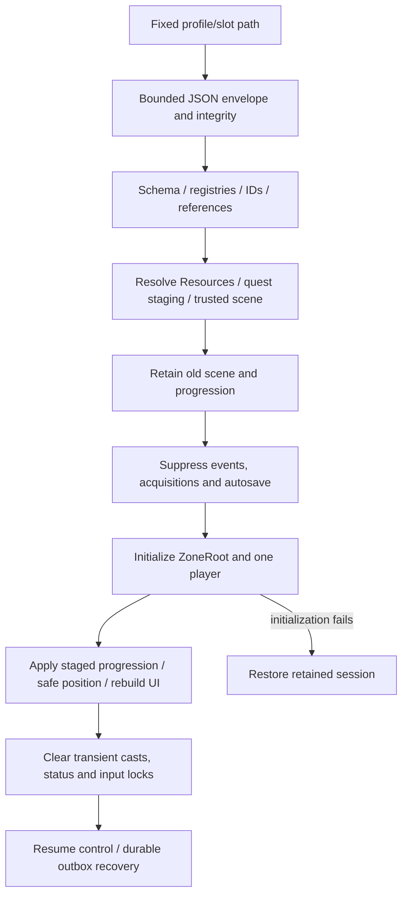

# Save/load architecture and content compatibility

The canonical schema, slot layout, staging, atomic write and recovery policy are in [Save system V1](../save-system-v1.md). SaveManager orchestrates; QuestSaveService still serializes the authoritative quest/reward/inventory/learned-spell state. Player extras hold academic/identity/vitals and ordered equipped spell IDs, not duplicate inventory/XP/currency.

## What happens when I add, rename, move or remove a Resource?

| Change | Safe procedure |
| --- | --- |
| Add spell/item/quest/enemy | Choose a new stable ID, register all dependencies, test source and PCK, then a fresh-process save/load of the new state |
| Change display text/icon/balance | Keep stable IDs and UIDs. Existing saves resolve current definitions. Review changed objective requirements against saved progress bounds |
| Move/rename file | Move using Godot's FileSystem, preserve UID, update path-based preloads/manifests and regenerate appropriate baked paths. Test a saved pre-move ID |
| Rename gameplay ID | Treat as a schema/content migration, not a cosmetic change. Update saved references, equipped/learned arrays, quest objectives/prerequisites/claims and event references as applicable before staging |
| Remove a spell/item/quest/subject/scene | Existing saves referring to it currently fail validation. Keep a compatible definition/registered identity until an explicit migration can translate it |
| Rename enemy/NPC/status/object integration key | Inspect kill/status/dialogue event targets, live quest instances and receipt histories; these are semantic keys even where not independently stored as a catalogue |
| Reparent persistent world object | Its scene+node-path hash changes. Migrate relevant world flags or preserve its authored path; preserving only its Godot UID does not preserve this flag identity |
| Add course | Reference it from progression UI and add it to GameSaveSchema.COURSES; otherwise saving its completed subject IDs fails |

There is no general content-ID remapper. Adding a real migration requires code: read old schema, validate known old references, translate the complete coherent bundle, stage it and write a new version while preserving originals. Do not make the loader silently omit missing items/claims to “repair” a save. Keep reward/acquisition/event receipts with the corresponding state; pruning them alone invites replay.

Quest V2 import is an explicit one-time path into an empty profile. It preserves the original legacy file and uses authored safe defaults for absent position, academics and spell equipment. It is not an automatic global bootstrap. Manual and autosave destinations are separate per profile; backup loading is explicit. Temporary statuses, enemies, loot instances and casting queues do not restore. Checkpoints validate clear grounded coordinates. Multiplayer persistence and cloud merging are unsupported.

For a content change, retain a representative old save under an isolated test profile, load it before and after the change in separate processes, check exact inventory/XP/reward claims, export and repeat. Never use a player's production file as a test fixture.
