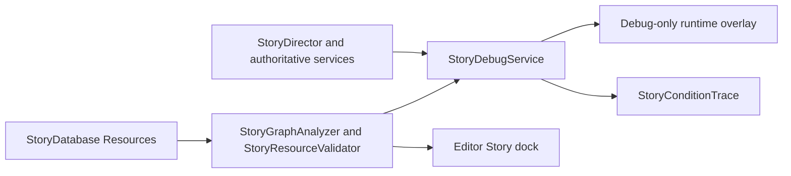

# Story debugger architecture

The debugger observes StoryDirector, QuestManager, CutsceneFlow, and SaveManager. `StoryDebugService` copies primitive state into each snapshot and keeps a bounded, in-memory event history. It never writes campaign data. Graph analysis and Resource validation operate on registered `.tres` references and can run in the editor without starting gameplay services.

`StoryConditionTrace` uses the existing evaluator for live leaf results and records structured reasons and nested short-circuit results. Its simulated mode accepts copied primitive snapshots and evaluates only supported pure conditions. Live gameplay facts such as quest, inventory, and cutscene state return UNKNOWN in simulation.

The runtime overlay is gated by Godot's debug feature and F12. The editor plugin is an `@tool` bottom panel. Both use the same static graph and validation classes. Story Resources remain the sole authoring source of truth.

The current graph layout is deterministic in authored stage order. Large graphs require search or chapter filtering; positions are generated and are not saved. A fresh scene-target scan is explicit to avoid per-frame tree traversal. Diagnostic revisions are in-memory display generations, not story state revisions.
