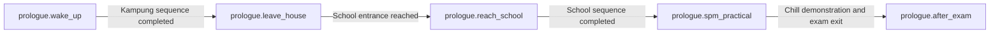

# Yan prologue integration

The production authoring graph lives in `res://data/story/definitions/story-database.tres`. Its five existing stage IDs remain stable. `StoryDirector` owns stage state and transition receipts; `QuestManager` owns accepted gameplay events and boolean world flags; `CutsceneFlow` owns sequence completion and the Kinetic Chill grant. The graph contains no spell or reward actions.

| Transition ID | Source → target | Requirement | Authoritative producer |
| --- | --- | --- | --- |
| `prologue.wake_up_to_leave_house` | `wake_up` → `leave_house` | `StoryCutsceneCondition` for `prologue.kampung` | `CutsceneFlow` sets `story_sequence:prologue.kampung` after natural completion or successful skip. |
| `prologue.leave_house_to_reach_school` | `leave_house` → `reach_school` | Current `LOCATION_REACHED` event for `prologue.school_entrance` | School scene controller publishes on fresh entry from the route. Restore never publishes it. |
| `prologue.reach_school_to_spm_practical` | `reach_school` → `spm_practical` | `StoryCutsceneCondition` for `prologue.school` | `CutsceneFlow` sets `story_sequence:prologue.school` after natural completion or successful skip. |
| `prologue.spm_practical_to_after_exam` | `spm_practical` → `after_exam` | `story.prologue.practical_demonstrated` plus the current `story.prologue.spm_completed` world flag event | School environment's Kinetic Chill receiver records the demonstration. The exam exit portal requires it; the FLAC entrance records completion after the route actually loads. |

The school scene has one authored spell receiver that reacts to Kinetic Chill. The breakable barrier and training turret are marked optional in the scene, so neither is treated as a required exam objective. The completion contract is: finish the school introduction, activate the Chill receiver, and use the existing end portal to reach FLAC. Entering the exam, learning the spell, or activating the receiver without reaching the exit cannot complete the stage. The portal retains `SceneManager` routing and spawn behavior.

The kampung and school scene controllers still call `CutsceneFlow`. The house portal requires the existing intro-completed condition, and the house controller retries an interrupted intro while that scene remains active. The school controller publishes arrival only when `Player_Manager.previous_scene_path` is the house route and observes the receiver. It records `story.prologue.left_house` and `story.prologue.reached_school` only after QuestManager accepts that arrival. `CutsceneFlow` rejects completed sequences, so reentry does not replay them; interruption does not set their completion flags. `CutsceneFlow` alone grants and equips Kinetic Chill. The existing after-final-paper sequence remains at the FLAC entrance and subway callers. The first successful caller records `story_sequence:prologue.after_final_paper`; later callers do not replay it. There is no authored Chapter 1 story stage yet, so `after_exam` is an intentional terminal graph node while the existing world route continues.

Save V1 embeds Story V1 state, stage IDs and receipts in its normal campaign snapshot. No separate prologue save exists. Restore suppresses arrival, receiver and exit completion events. Legacy saves without Story V1 infer only verified cutscene completions or the recorded school-arrival flag; otherwise they start conservatively at `wake_up`. A learned spell or an exam scene location alone does not prove practical success. The story objective uses each stage's `objective_hint` through the existing HUD goal list.

Use the F12 runtime debugger to inspect active stage, blocked transitions, flags and receipts. It is read-only. The Story Editor displays the production edges and validator findings; its visual authoring hotfix remains separate from this gameplay migration.
