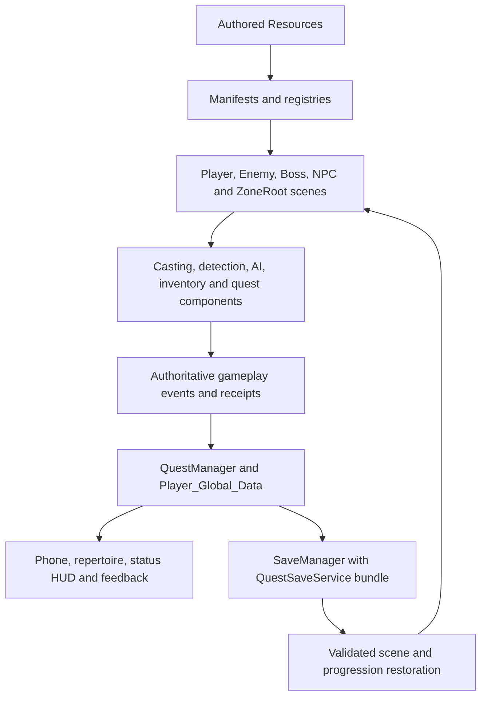

# System overview

Project autoloads initialize shared services; scene components own actor-local state. The project uses Dialogic for narrative and the existing SceneManager addon for transitions. Player_Global_Data owns local durable character progression plus explicitly transient flags; Player_Manager owns local player references/spawning. SaveManager coordinates persistence instead of copying inventory/reward authority into another store.

| Authority | Source | Role |
| --- | --- | --- |
| Local character | [player-data.gd](../../autoloads/player-data.gd) | Identity, vitals, academic completions/comprehension, learned/equipped spells |
| Player lifecycle | [player-manager.gd](../../autoloads/player-manager.gd) | One local player, authority IDs, spawn/history and HUD rebind signal |
| Spell catalogue | [spell-library.gd](../../autoloads/spell-library.gd) | ID/incantation lookup, validation and editor diagnostics |
| World catalogue | [world-manifest.gd](../../autoloads/world-manifest.gd), [scene-registry.gd](../../autoloads/scene-registry.gd) | SceneData registration, trusted scene ID resolution |
| Progress/rewards | [quest-manager.gd](../../autoloads/quest-manager.gd), [inventory-manager.gd](../../autoloads/inventory-manager.gd) | Quest instances, receipts, flags, transactions and inventory |
| Campaign persistence | [save-manager.gd](../../autoloads/save-manager.gd) | Slots, checkpoints, validation, restore and recovery |
| Network boundary | [network-manager.gd](../../autoloads/network-manager.gd) | Existing movement/session infrastructure; not full spell/quest/save replication |

Combat mutations use SpellExecutor authority checks; client UI or possession of an ID is not authorization. Enemy spell execution additionally requires its loadout. Campaign saves are disabled with a real network peer. See [combat](combat-architecture.md), [progression](progression-architecture.md) and [save/load](save-load-architecture.md).
