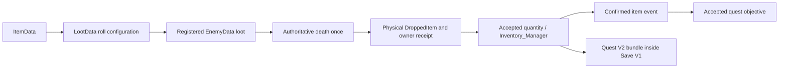

# Items, equipment and loot

## Schemas and working examples

[ItemData](../../data/items/item-data.gd) describes inventory identity, stacks, presentation, pickup effects and recipe ingredients. [LootData](../../data/loot/loot-data.gd) describes a roll yielding that item. Examples: [fish-bone.tres](../../data/items/drops/fish-bone.tres), [drop-002.tres](../../data/loot/bakau/drop-002.tres) and the registered Bakau enemies. Keep items under data/items/ and loot entries under data/loot/ in descriptive content folders.

| Important property | Required / behavior |
| --- | --- |
| item_id / item_name | Stable nonempty ID required; readable name for UI |
| item_icon / description / item_type | Presentation/category. ItemType enum is in the reference; category alone does not implement use/equipment rules |
| is_stackable / max_stack | Nonstackable effective cap 1; otherwise positive max_stack; one inventory entry per item ID |
| ringgit_value / is_sellable | Authored economy metadata; no complete sale/shop transaction uses them in current runtime |
| health_restore / mana_restore / exp_reward / spell_to_unlock | Applied on Inventory_Manager.pickup for accepted quantity; not an explicit-use consumable API |
| tags | Published on confirmed item events; useful for cumulative objective matching |
| quest_objective_ids | Retained legacy metadata; current normal acquisition publishes item IDs/tags, not this array as automatic quest credit |
| ingredient_1..3 / qty_1..3 | ItemData recipe output's input references/quantities, consumed by CraftingUI |
| Loot item | Required ItemData reference |
| drop_chance / min_quantity / max_quantity | Chance 0–1, integer quantities at least 1 and ordered, maximum ≤ 9999 |
| extra_drops | Explicit bundle sharing the entry's successful roll, not independent per-item rolls |
| rarity_color / rarity | Color applied to pickup particles; enum label is authored metadata, not automatic probability/tier effects |

## Walkthrough: item → enemy drop → pickup → quest

1. FileSystem → data/items/<content>/ → New Resource → ItemData. Save new file, set unique item_id, name, optional existing icon/description/category, sensible stack settings and tags. Keep published IDs stable.
2. Register a standalone item in `data/items/item-manifest.gd` ITEMS. Alternatively, attaching it to a **registered** EnemyData.loot entry makes QuestRegistry register it (and explicit extra_drops) automatically. A recipe, quest reward or random world reference by itself is not this registry path.
3. Create LootData in data/loot/<content>/, assign item, set drop_chance (use 1 for a temporary deterministic test, restore intended balance), min/max and optional color. Set equal quantities for deterministic results. Give independent drops separate LootData entries; extra_drops shares the parent roll and quantity bounds.
4. Add the loot Resource to the new/existing EnemyData.loot. Check its enemy manifest entry. EnemyLootComponent processes death once under authority, spawns the existing DroppedItem scene and assigns actual quantity/credited owner; do not add a second death callback awarding inventory.
5. Defeat the enemy through its hitbox in a playable test scene. The physical pickup becomes collectible after its short gate; touching the player routes through Inventory_Manager.pickup with a stable receipt for that drop part. Verify accepted quantity, partial stack/full inventory behavior and that overlap cannot award twice. A runtime-assembled standalone DroppedItem must have loot_data assigned before parenting; loot_data is not an exported editor field.
6. Add a QuestObjectiveData COLLECT_ITEM using exact item_id, or cumulative target_tags when appropriate. Register the quest through its database. Objective credit follows confirmed acquisitions; dropping/spawning a visual item is not acquisition. See [quests](quests.md).
7. Save/load the item/equipment state in a separate process and exported pack. Unknown item IDs reject a save; preserve IDs or design a migration before removing old items.

## Equipment and consumption boundary

Inventory_Manager supports WEAPON/OFFHAND/ROBE/ACCESSORY_1/ACCESSORY_2 slots and atomic swap plans. equip_item requires actual inventory quantity, moves one item into the slot and returns the previous item only if capacity permits. There are no ItemData attack/armor attribute fields or universal slot restrictions/stat recomputation. Do not document an armor bonus that has no schema or consumer. Inventory UI and stat presentation are not a character equipment build system.

ItemType.KEY_ITEM is a category label; the separate dungeon Key/LockedDoor scenes use matching key_id and Player_Global_Data key metadata, not an automatic inventory-item-to-door link. Save V1 persists that existing key possession and world collection/open flags.

Pickup health/mana/XP/spell effects occur on accepted pickup and are scaled by acquired quantity where applicable. Direct add_item, reward inventory transactions and crafting do not replay those pickup effects. Consumable item_type does not consume a stack on button press through an absent generic use API. New explicit use/shop/gear-stat behavior requires code and transaction tests.

## Validation and checklist

LootData.validate checks reference/probability/quantity bounds. QuestRegistry checks item identity/max_stack and duplicate item objects under the same ID; Inventory_Manager also checks incoming quantities/capacity. ItemData itself has no standalone validate method. Test items reachable through actual sources, not only a manually edited inventory dictionary. Enemy/quest suites cover existing loot/inventory transactions; new definitions require new targeted checks and visual pickup review.

Completion: ID/name/stack valid; item registered; loot attached to registered enemy; source obtainable; no duplicate pickup credit; quest target correct; PCK reference chain valid; save compatibility and implemented-use limitations understood.

## Item and loot execution flow

