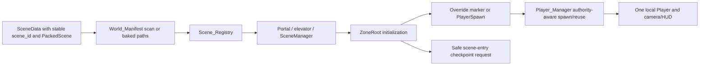

# Worlds, rooms, portals and elevators

## Sources and existing structure

[SceneData](../../data/Resources/worlds/scene-data.gd) maps a stable scene_id to a PackedScene and display name/default marker/description. Store it under data/worlds/hubs/ so World_Manifest can find it. [world-template.tscn](../../scenes/worlds/world-template.tscn) uses [ZoneRoot](../../data/worlds/zone-root.gd) and the World/GameComponents hierarchy. Scene_Registry resolves IDs; SceneManager performs transitions; Player_Manager spawns/reuses the authoritative local player.

## Editor walkthrough: new accessible room with enemy and NPC

1. Open world-template.tscn and create an inherited scene under scenes/worlds/hubs/<content>/. Keep the root Node's exact ZoneRoot script for campaign persistence. Do not add a second permanent Player child: ZoneRoot spawns it.
2. Author floor/walls/platform collision, background and camera-safe space. Project physics layers are named in project.godot; ordinary world terrain uses layer bit 16, player default bit 1, enemy bit 2. Use Inspector layer checkboxes and verify actual masks rather than confusing a bitmask with a layer number.
3. Add a Marker2D named PlayerSpawn under World/GameComponents/SpawnPoints (or another discoverable descendant). Put its origin at the **player body's center**, clear of solids with nearby supporting ground. NPC placement markers use feet; these two conventions differ. Include explicit arrival markers for doors/elevators if desired.
4. Set root zone_combat_mode for the room. Add the new enemy instance or EnemySpawner configured with reachable SpawnData as in [enemies](enemies.md). Add a grounded quest NPC/RoomQuestManager with clear access markers as in [NPCs](npcs-and-dialogue.md). Do not place test-only training loadouts in campaign initialization.
5. FileSystem → data/worlds/hubs/<content>/ → New Resource → SceneData. Set unique scene_id (lowercase underscores for new IDs), scene = your saved scene, scene_name, description and default_spawn_marker if used by elevator selection.
6. Run tools/bake-world-manifest.gd as EditorScript (Ctrl+Shift+X). Review autoloads/world-manifest-paths.gd. The runtime scan recursively loads .tres in that hub folder; don't put unrelated Resource types there. Export uses the baked fallback when no files are discoverable.
7. Add the existing `scenes/transitioners/zone-portal/zone-portal.tscn` to a reachable campaign room. Set next_scene_id to your new ID, is_door as intended and spawn_marker_override to an arrival marker when needed. Test both outbound and return routes. Portals save previous position/path; NPC destination and elevator transitions also establish return state for UI rooms.
8. For an elevator, New Resource → ElevatorFloor in its floors array. Set floor_name, registered scene_id, optional spawn_marker_override, locked and locked_hint. ElevatorPortal priority is portal override → selected floor marker → SceneData.default_spawn_marker. `use_locking=false` duplicates/unlocks presentation entries; there is no automatic academic unlock handler for locked floors.
9. Enter via the actual route, verify the one local player, location label, combat UI, spawn clearance, NPC accessibility, enemy detection and return route. Save and load the new scene from a separate process/PCK. A folder/manifest entry alone does not make a room reachable from the campaign.

## Spawn and save contract

ZoneRoot searches a pending next_spawn_marker first, then PlayerSpawn, then last_player_position, finally (0,0) with warning. It does not generally read SceneData.default_spawn_marker itself. A named explicit portal override avoids relying on the wrong default behavior. Missing arrival markers can silently fall back after warning, so inspect the actual final player coordinate. Returning from a UI room does not guarantee the exact old coordinate: a found explicit/default marker takes precedence over last_player_position. Use explicit arrival markers for a deliberate return policy; full-save load restores its staged coordinate after initialization instead.

SaveManager accepts only registered campaign scenes whose root uses the exact ZoneRoot script. A custom subclass/root controller needs a reviewed persistence extension; merely registering a UI room does not make it saveable. Ordinary load waits for existing scene/player initialization, applies saved position after readiness and uses a validated PlayerSpawn fallback for solid overlap. On safe scene entry, a usable PlayerSpawn can become a checkpoint. Place `components/save/checkpoint.tscn` for explicit local-player checkpoints; its Respawn marker must be clear, grounded within 240 world units and away from hazards.

Persistent object flags currently cover collected dungeon keys/open doors/broken nonrespawning props. Their hashed identity depends on scene path + node path; moving/reparenting a released object requires a flag migration. Enemy and dropped-loot populations are transient. Load-safe story scripts must avoid reopening dialogue or granting content during SaveManager.loading; the current prologue examples show that guard.

## Validate and troubleshoot

Use static referenced-file checks, editor import, NPC world-boot fixtures, actual transition play and exported-pack entry. Scene ID misses usually mean the wrong folder, missed bake, duplicate ID or bad next_scene_id. Repeated players usually indicate manually placed Player plus ZoneRoot spawning. Embedded spawns require fixing the authored marker/collision, not disabling safety checks. A return button in a standalone F6 UI scene may have no previous_scene_path; enter it through its actual NPC/portal route.

Completion: scene and SceneData linked; stable ID/UID; world manifest baked; explicit reachable routes; safe distinct spawn conventions; enemy/NPC dependencies retained; one-player and source/PCK/save/return tests.

## Registration and spawning flow

