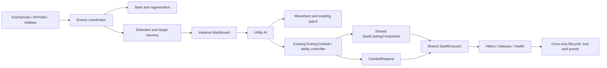

# Enemy Pipeline V2

Current handbook entry: [authoring/architecture guide](authoring/enemies.md). Schema defaults and current source remain authoritative; any dated test paragraphs below retain their original verification scope.

The existing Enemy scene is the reusable gameplay shell. Pohon, Bunga and the training guardian use the same controller. EnemyData and its nested typed resources define configuration; active health, mana, cooldowns, threat, memory, decisions and effect entries remain instance-local. Shared definitions are never used as writable runtime storage.

## Components

| Component | Responsibility |
| --- | --- |
| Enemy | Initialize/register components, preserve legacy interfaces, coordinate ticks, interrupt on damage, resolve death and forward signals |
| EnemyStatsComponent | Apply stat configuration to legacy public fields, health/mana changes, regeneration delay, mitigations and resistance configuration |
| EnemyDetection | Reused name/API; bounded multi-candidate scans, faction filtering, terrain LOS, decaying threat, last-seen memory and blackboard |
| EnemyAIController | Utility eligibility/scoring, action commitment, decision interval, action cooldowns and configured ability selection |
| EnemyMovementComponent | Execute intent using velocity, distance bands, ledge checks and existing patrol helpers |
| EnemyCombat | Existing component becomes the ability controller: loadout authorization, range/LOS/resource checks, telegraphed windup, release revalidation, cooldown, recovery and shared casting |
| EnemyPatrol | Existing home/range/edge/wall-jump behavior; left/right ray selection corrected |
| EnemyAnimationComponent | Actual state-driven animations, replacing Bunga's proximity-only attack toggle; existing sprite frames and appearance remain |
| HitboxComponent / ActiveEffectManager | Shared damage mitigation, source attribution, status durations/resistances, knockback resistance and owner-ticked effects |
| EnemyLootComponent / EnemyQuestObserver | Existing integrations, once-only authoritative reward guards, exact quest enemy matching and synchronous drop dispatch before deletion |
| CombatRequest / CombatFactions / CombatLifecycle | Non-spell effect requests, consistent relation rules and explicit ownership/cleanup |

Resources: EnemyData, EnemyStatsData, EnemyPerceptionData, EnemyAbilityData, EnemyAIProfile and EnemyAIAction. See the [authoring guide](enemy-authoring-guide.md).

## Lifecycle

`_ready` chooses an explicit EnemyData, a legacy NPCSpellcasterData adapter or a legacy scene-export adapter. Validation precedes setup. Configuration references stay shared; loadout arrays, dictionaries and hitbox resistance dictionaries are copied. Dynamic components append after inherited scene nodes, preserving existing scene node indices, UIDs and paths.

Authoritative physics ticks stats, perception, patrol, ability lifecycle, decisions and movement. The shared casting component owns its own preparation/channel ticks. Root state values remain IDLE, PATROL, CHASE, ATTACK, HURT, DEATH and RETURN; the higher-level intent carries more specific actions without expanding the legacy enum. Damage cancels preparation/windup and enters hurt recovery. Stun blocks movement/actions; silence blocks magical abilities while ordinary melee remains available.

Death sets `combat_dead` before callbacks, cancels abilities, clears owned statuses, disables collision, cleans owned projectiles/areas/constructs/minions, emits once, grants configured XP once and waits a bounded EnemyData death delay. Loot and quest observers have independent once guards. Already-applied statuses on other targets remain target-owned and expire under the existing Magis policy. Despawning cleans owned entities without awarding kill rewards.

## Perception and factions

Hitboxes register parents in `combat_target`; `player` remains a default group. Compatible NPCs and summons with hitboxes or explicitly configured groups can be candidates. Pure defensive constructs without health are not automatically damageable targets. A scan runs every 0.2 seconds by default. Candidates are deduplicated and sorted by `threat * 10 - distance + 20 for current target`; at most sixteen candidates receive LOS checks. LOS uses terrain layer 16 by default, with an exclusion for the caster. No per-frame raycast across every actor is required.

The blackboard stores target, visibility, last-known position, distance, threat, health/mana ratios, recent damage, available abilities and intent. LOS loss retains the last visible position for 2.5 seconds by default; it does not update the remembered point through a wall. Expiry clears the target; freed/dead nodes are rejected before typed access.

`faction_id` defaults to `spell_team`, then player/enemy group behavior. Same faction is allied. Neutral is non-hostile. A perception resource's relations dictionary can assign other factions -1 hostile, 0 neutral or 1 allied. Shared delivery, direct attacks, projectile fields and reflective constructs use these relations. Player/enemy projectiles retain masks 18/17; additional factions use both actor layers plus terrain and rely on relationship filtering.

## Spawning

SpawnData retains its scene and weight and adds an optional EnemyData override. EnemySpawner preserves start/stop APIs, timing, rectangular areas and weighted pools. Positive finite weights only are eligible. Population accounting includes pending reservations. Deferred commits instantiate, validate data/root/placement, set local coordinates from the desired world point, parent, then register. Shape queries include the spawner parent's transform; solid/actor overlap is rejected, with bounded placement attempts.

Death and tree exit remove active tracking. Respawn is optional; disabling it limits lifetime successful spawns to max_enemies. Stop/removal invalidates queued requests without leaving orphan instances. Already-spawned enemies remain independent of a removed spawner. Enemies receive a monotonically allocated process-wide spawn ID; the ID is stored as enemy_network_id metadata for future replication.

## Bosses and compatibility

Boss still owns phases, weighted selections, movement, dashes, warning timings and summoning. It now shares perception, SpellCastingComponent, CombatRequest and owned-entity cleanup. BossPhaseData optionally overrides defense, damage multiplier and status resistances; negative mitigation values preserve base stats. Invincibility uses the shared hitbox. Attack epochs reject delayed hits after interruption/phase changes/death. Bursts preserve their interval and use initialized shared casts; a spell's upfront cost is divided across the burst with ceiling rounding per shot. Counts are bounded to 32 burst shots and twelve owned minions. Transition/death animation waits are bounded to prevent looping inherited animations hanging lifecycle.

The training dummy's public take_damage behavior remains; an already-optional missing HpLabel now uses a null-safe lookup. Other UI, courses, quests, items and player controls are preserved.

## Authority and remaining limits

Server authority gates enemy simulation, perception, decisions, movement, resource changes, ability dispatch, damage, spawning, rewards and quest notifications. No client damage/cast RPC is introduced. The existing ENet/Noray connection setup is untouched. Tests verify client denial using an ENet peer; they do **not** establish a complete multiplayer game.

Enemy spawn/state/transform replication, client-side visual events, late-join snapshots, cross-peer spawn-ID distribution, projectile reconciliation and replicated loot/quest/XP distribution remain unimplemented. IDs are server-side foundations, not a completed synchronization protocol. Offline/host XP updates the existing singleton; per-player multiplayer reward attribution remains future work.

Movement is a 2D local platform controller with edge/wall tests and wall jumps, not navigation-mesh pathfinding. Threat discovery scans registered groups rather than a spatial index. No sustained frame-time or long-session balance benchmark was performed. NPCSpellcasterData's dormant mana-shield, combo/counter probabilities, delayed reactions and spell-drop hooks are preserved in the original resources but not given invented semantics by the adapter. Optional visual_scene is an appearance-only Node2D addition; existing Enemy sprite frames remain the standard animation driver.
